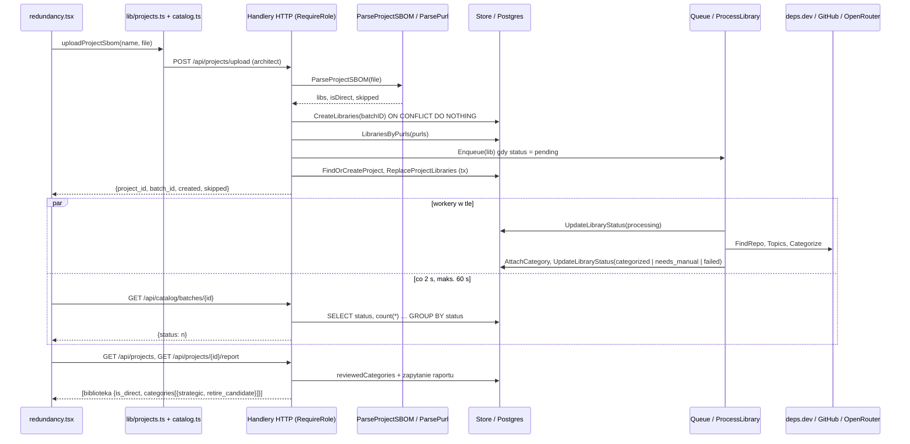

# Research: przepływ raportu redundancji

**Data**: 2026-10-27T23:29:49+01:00
**Badacz**: Claude Opus 5.5 (Claude Code), dla Tomasza Świerszcza
**Commit**: 47a1e0a
**Gałąź**: shape/shelfmark
**Repozytorium**: tswierszcz/shelfmark

## Pytanie badawcze

Jak działa dziś przepływ raportu redundancji: upload SBOM projektu → zapis `project_libraries` → wzbogacanie i kategoryzacja bibliotek (kolejka, deps.dev, GitHub, OpenRouter) → status paczki (polling) → raport (strategiczne / kandydaci do wycofania)? Szczególnie w strefach ryzyka 1 i 2 z `context/map/repo-map.md` (raport + status paczki; wspólna warstwa danych `catalog/store.go` + `handlers.go` ze znacznikami strategicznymi). Trzy wymiary: śledzenie przepływu od początku do końca, luki w testach, zasięg oddziaływania. Tylko stan obecny, bez propozycji zmian.

Konwencja oznaczeń: **[D]** dowód (przeczytany kod, `plik:linia`), **[I]** interpretacja / wniosek z kodu, którego nikt nie uruchomił, **[?]** biała plama.

## Summary

Przepływ ma pięć kroków i działa na jednym synchronicznym żądaniu plus asynchronicznej kolejce w procesie. **[D]** Upload (`POST /api/projects/upload`, rola architect) parsuje CycloneDX, dopisuje nowe purle do katalogu z nowym `upload_batch_id`, wrzuca do kolejki tylko biblioteki w stanie `pending`, a potem zastępuje członkostwo projektu w jednej transakcji (`project_handlers.go:28`, `project.go:107`). Kolejka (5 workerów, do 3 prób) przeprowadza bibliotekę przez deps.dev → OpenRouter → GitHub → kategoryzację LLM i ustawia status końcowy (`queue.go`, `pipeline.go`). UI odpytuje status paczki co 2 s, najwyżej 60 s (`redundancy.tsx:20-21`), a potem pobiera raport. Raport to jedno zapytanie SQL z regułą „kandydat do wycofania = bezpośrednia ∧ kategoria przejrzana ∧ nie strategiczna” (`project.go:227`).

Najważniejsze ustalenia:

1. **[D]+[I] Raport ignoruje ekosystem, choć limit znaczników go uwzględnia.** `reviewedCategories` (`project.go:242-244`) i JOIN na `strategic_marks` (`project.go:207-208`) kluczują tylko po kategorii, a `MarkStrategic` liczy limit po parze (kategoria, ekosystem) (`store.go:428`). Dziś to nie szkodzi, bo `ParsePurl` przepuszcza tylko Maven (`purl.go:19`). Plan z 19.10 zapisał to założenie wprost (`context/archive/2026-10-19-project-redundancy-report/plan.md:21`). To uśpiony rozjazd z FR-007.
2. **[D] Ryzyko #4 z test-planu (agregacja między projektami) nie ma żadnego testu.** Jedyny scenariusz agregacji to jeden projekt (`project_handlers_test.go:437`). Każde wywołanie `doProjectUpload(` w testach dotyczy jednego projektu.
3. **[I] Status paczki może powiedzieć „done”, gdy raport pokazuje „Processing”.** Licznik paczki obejmuje tylko biblioteki nowe w tej paczce (`store.go:342-344`). Biblioteka już obecna w katalogu, ale wciąż `pending` z wcześniejszej paczki, jest ponownie kolejkowana (`project_handlers.go:102-103`), a nie liczy się do nowej paczki.
4. **[D] Kontrakt HTTP Go ↔ TS trzymają tylko konwencja i jeden test e2e.** Typy w `web/app/lib/projects.ts` są pisane ręcznie i nigdy nie zmieniły się w tym samym commicie co struktury Go (1 commit `projects.ts` wobec 3 commitów zmieniających strukturę raportu w Go). `SkippedRow` nie ma tagów JSON (`sbom.go:13-16`).
5. **[D] Komentarz w parserze przeczy kodowi.** `project_sbom.go:23-25` mówi, że komponent nieobecny w `dependsOn` korzenia jest „direct”, a `project_sbom.go:91` zwraca dla niego `false` (transitive).

## Przegląd funkcjonalności

### Sekwencja kroków [D]

1. **Wejście w UI.** `web/app/routes/redundancy.tsx`: `RequireAuth` dla ról architect i viewer; formularz uploadu widzi tylko architect. `handleUpload` woła `uploadProjectSbom` (`web/app/lib/projects.ts:45-63`, multipart `project_name` + `file`).
2. **Routing i role.** `backend/cmd/shelfmark/routes.go:58`: upload tylko dla architect przez `auth.RequireRole` (`internal/auth/middleware.go:29`). Raport (`routes.go:60`) dla architect i viewer; status paczki (`routes.go:51`) dla admin i architect.
3. **Handler uploadu** `ProjectUploadHandler` (`project_handlers.go:28`): limit 10 MB (`handlers.go:40`) → sesja → `project_name` → `file` → `ParseProjectSBOM`.
4. **Parsowanie** `ParseProjectSBOM` (`project_sbom.go:26`): korzeń z `metadata.component.bom-ref`, zbiór bezpośrednich z jego `dependsOn`. Komponent bez purla lub z purlem odrzuconym przez `ParsePurl` trafia do `skipped`. `ParsePurl` przyjmuje tylko `maven` (`purl.go:19-20`) i ustawia `Ecosystem: "maven"` (`purl.go:31`).
5. **Zapis bibliotek.** `newBatchID` (`handlers.go:429`) → `CreateLibraries` (`store.go:107`, `INSERT … ON CONFLICT (purl) DO NOTHING`, więc batch dostają tylko purle nowe dla katalogu) → `LibrariesByPurls` (`project.go:73`) rozwiązuje wszystkie purle niezależnie od paczki.
6. **Kolejkowanie.** Upload projektu kolejkuje tylko `Status == "pending"` (`project_handlers.go:102-103`); upload katalogu kolejkuje każdą nowo utworzoną bibliotekę bez sprawdzania statusu (`handlers.go:139`), a `Sweep` robi to z `queue.go:173` (3 miejsca wywołania `Enqueue` poza testami; raport: opisane jako „tylko pending” bez zastrzeżenia ścieżki). Kolejka to kanał w procesie, wiązany w `main.go`; przy starcie `Sweep` ponownie kolejkuje biblioteki zawieszone w `pending`/`processing` dłużej niż 10 min (wg raportu subagenta: `queue.go:161`, `store.go:230`).
7. **Zapis projektu.** `FindOrCreateProject` (`project.go:51`, nazwa bez rozróżniania wielkości liter, migracja 0004) → `ReplaceProjectLibraries` (`project.go:107`, DELETE + INSERT `(project_id, library_id, is_direct)` w jednej transakcji). Odpowiedź: `project_id, project_name, batch_id, created, skipped`.
8. **Wzbogacanie** (asynchronicznie): `processing` → do 3 prób `ProcessLibrary` → `categorized` / `needs_manual` / `failed` z `error_detail` (migracja 0007). `needs_manual`, gdy nie znaleziono repozytorium, model nie był pewny albo nie przypięto żadnej kategorii.
9. **Status paczki.** `GET /api/catalog/batches/{id}` → `BatchProgressHandler` (`handlers.go:156`) → `BatchProgress` (`store.go:342`, `GROUP BY status` po `upload_batch_id`). UI uznaje paczkę za zakończoną, gdy każdy klucz jest w zbiorze `{categorized, needs_manual, failed}` (`redundancy.tsx:19, 26-27`). Pusty obiekt `{}` też liczy się jako zakończony. Polling: co 2 s, limit 60 s (`redundancy.tsx:20-21`), stop także na błędzie.
10. **Raport.** `GET /api/projects/{id}/report` → `ProjectReportHandler` (`project_handlers.go:163`) → `projectExists` (404) → `ProjectReport` (`project.go:194`) → grupowanie wierszy po bibliotece w handlerze.
11. **Render.** Płaska tabela, jeden wiersz na bibliotekę: purl, Direct, repo GitHub, kategorie z odznakami „Strategic” / „Retire candidate”, kolumna „Retire?”. Biblioteka bez kategorii pokazuje odznakę statusu. Widoku pogrupowanego po kategoriach nie ma.

### Reguła raportu [D]

- Zapytanie `project.go:200-210`: `project_libraries` ⨝ `libraries` ⟕ `library_categories` ⟕ `categories` ⟕ `strategic_marks ON sm.library_id = l.id AND sm.category_id = c.id AND sm.active`.
- Reguła `project.go:227`: `RetireCandidate = CategoryID != nil && IsDirect && reviewedCategories[CategoryID] && !Strategic`.
- „Kategoria przejrzana” (`project.go:242-244`): `SELECT DISTINCT category_id FROM strategic_marks WHERE active`, czyli globalnie, w całym katalogu, bez filtra ekosystemu. Uzasadnienie w komentarzu `project.go:237-241`: nieprzejrzana kategoria nigdy nie produkuje kandydatów.
- Bezpośredniość jest per projekt: `project_libraries.is_direct` (migracja 0004), a migracja 0005 usunęła `libraries.is_direct`. Zależności przechodnie nigdy nie są kandydatami.
- Biblioteka `pending` / `failed` / bez kategorii daje wiersz z pustą kategorią i `categories: []`, więc nie może być kandydatem (warunek `CategoryID != nil`).

### Limit znaczników strategicznych [D]

`MarkStrategic` (`store.go:384`) odczytuje ekosystem biblioteki, bierze advisory lock na parę (kategoria, ekosystem) i liczy aktywne znaczniki z `l.ecosystem = $2` (`store.go:428`). Limit: 2 na parę (`store.go:29-31`).

## Luki w testach

Wszystkie testy backendu na tej ścieżce poza parserami to testy integracyjne na prawdziwym Postgresie uruchamianym przez `docker run` (`store_test.go:27`); bez Dockera są pomijane. CI uruchamia `go test ./...`.

| Obszar | Pokrycie | Dowód |
|---|---|---|
| Parser: graf pełny, brak grafu, nierozwiązany korzeń, pominięte wiersze | jest (unit) | `project_sbom_test.go:146` |
| Parser: błąd dekodowania, zły `bomFormat`, brak komponentów — dla **ParseProjectSBOM** | **brak** (te gałęzie ma tylko `ParseCycloneDXSBOM`) | `sbom_test.go:54, 61` |
| Upload: ścieżka szczęśliwa, za duży plik, brak nazwy | jest (httptest + PG) | `project_handlers_test.go:142, 208, 250` |
| Upload: brak pliku, błąd parsera, gałęzie 5xx | **brak** | — |
| Ponowny upload zmniejszający zbiór bibliotek | jest | `project_handlers_test.go:270` |
| Ponowny upload: wzrost, zmiana direct ↔ transitive, nazwa różniąca się wielkością liter | **brak** | — |
| Reguła raportu: strategiczna, niestrategiczna w przejrzanej kategorii, nieprzejrzana, przechodnia | jest, **jeden projekt** | `project_handlers_test.go:437` |
| **Kilka projektów dzielących bibliotekę; kolejność uploadów między projektami** | **brak** | wszystkie wywołania `doProjectUpload(` w testach |
| Znacznik strategiczny w innym ekosystemie a raport | **brak** | — |
| Biblioteka strategiczna w jednej kategorii, a kandydatem w innej (kolumna „Retire?” = `some()`) | **brak** | — |
| Limit 2 w interakcji z raportem (2 strategiczne + N niestrategicznych) | **brak** (limit testowany tylko na poziomie store/handlera) | `store_test.go:320, 703, 779, 914`, `handlers_test.go:787` |
| Biblioteki pending / needs_manual / failed w raporcie | jest | `project_handlers_test.go:142, 647` |
| Pusta paczka `{}` | jest | `json_contract_test.go:159`, `project_handlers_test.go:809` |
| Pusty SBOM na endpoincie projektu | **brak** | — |
| Ponowny upload, gdy pierwsza paczka jest jeszcze `pending` | **brak** (test `:809` ma tę sytuację, ale nie sprawdza podwójnego kolejkowania) | `project_handlers_test.go:809` |
| Kolejka i pipeline: wszystkie stany końcowe, ponowienia, panic, sweep | jest (fake'i + PG) | `queue_test.go`, `pipeline_test.go` |
| OpenRouter `Categorize` / `FindRepo` | **brak** (testowane tylko `sanitize`) | `openrouter_test.go:8, 60` |
| Surowy kształt JSON (`[]` zamiast `null`) | jest dla uploadu, statusu, listy projektów, pustego raportu, `categories` | `json_contract_test.go:159, 208`; `project_handlers_test.go:600, 620, 647` |
| Frontend `redundancy.tsx`, `lib/projects.ts` (unit/component) | **brak** (nie ma runnera; Faza 4 test-planu) | `web/package.json` |
| E2E | jest jeden spec: „done”, 3 wiersze, Direct = Yes, kategoria, ponowny upload | `web/tests/e2e/sbom-upload-report.spec.ts:61-97` |
| E2E nie sprawdza odznak Strategic / Retire, „No” dla przechodnich, roli viewer, błędów | **brak** | jw. |
| E2E w CI | **brak** (CI: `go vet`, `go test`, `typecheck`, `build`) | `.github/workflows/ci.yml` |

**[D]** Ryzyko #4 z `context/foundation/test-plan.md` wymaga fixture'a z wieloma projektami „regardless of upload order”. Dziś jest pokryte jednym projektem.

## Zasięg oddziaływania

### Szew HTTP Go ↔ TS [D]

| Endpoint | Go | TS |
|---|---|---|
| `POST /api/projects/upload` | `projectUploadResponse` (`project_handlers.go:13-19`) | `ProjectUploadResult` (`projects.ts:28`) |
| `GET /api/catalog/batches/{id}` | `BatchProgress map[string]int` (`store.go:89`) | `Record<string, number>` (`catalog.ts:34`), reeksport w `projects.ts:87` |
| `GET /api/projects` | `Project` (`project.go:13-18`) | `Project` (`projects.ts:3`) |
| `GET /api/projects/{id}/report` | `projectReportLibrary` (`project_handlers.go:147-151`, osadza `Library` z `store.go:54-64`) + `projectReportCategory` (`:137-142`) | `ProjectReportLibrary` / `ProjectReportCategory` (`projects.ts:10-26`) |

- `SkippedRow` bez tagów JSON (`sbom.go:13-16`) serializuje się jako `Index`/`Reason`; TS (`catalog.ts:23`) odwzorowuje domyślne nazwy Go. Zmiana nazwy pola w Go po cichu zmieni klucz.
- `is_direct` występuje w serializowanym kształcie raportu dwa razy: `Library.IsDirect` (`store.go:62`) i `projectReportLibrary.IsDirect` (`project_handlers.go:149`); trzecie pole z tym tagiem, `ProjectReportRow.IsDirect` (`project.go:40`), nie jest serializowane wprost (3 pola z tagiem w pakiecie; raport: 2). **[I]** Wygrywa płytsze pole, czyli wartość per projekt. Usunięcie zewnętrznego pola wypuściłoby `false` z osadzonego `Library`.
- `status` to wolny `string` po obu stronach. Dozwolone wartości są tylko w CHECK migracji 0002, a zbiór „zakończonych” jest skopiowany w `redundancy.tsx:19` i `catalog.tsx:17`.
- Brak OpenAPI i typowanego klienta. Połączenie frontu z backendem jest wykrywalne tylko po dopasowaniu stringów `/api/...`.

### Model i migracje [D]

Tabele `libraries`, `categories`, `library_categories`, `strategic_marks`, `project_libraries` są czytane i zapisywane z **dwóch** plików: `project.go` i `store.go`. Raport czyta `strategic_marks` bezpośrednio w SQL (`project.go:207`, `:244`), z pominięciem metod `Store` dla znaczników. `store.go:161` (`ListLibraries`) wylicza katalogowe `is_direct` jako `EXISTS` po `project_libraries` dowolnego projektu, czyli w innym znaczeniu niż raport.

### Współzmiany z historii [D]

- Pary logiczne: `project.go` ↔ `store.go` (3 commity), `project.go` ↔ `project_handlers_test.go` (4), `store.go` ↔ `handlers.go` (4), `pipeline.go` ↔ `queue.go` (2), `sbom.go` ↔ `csv.go` (2), `redundancy.tsx` ↔ `catalog.tsx` (2, kopiowane fallbacki i zbiór statusów).
- **Brak współzmian Go ↔ TS:** struktura raportu w Go zmieniała się w 3 commitach (74daf0f, 4a6d826, ad2e7dd), a `projects.ts` ma 1 commit (5a4da5e). **[I]** Kształty dziś się zgadzają, więc albo dryfu nie było, albo nikt go nie zauważył.
- Mechaniczne: `main.go`, `routes.go`, `routes.ts`, kitchen-sink, `context/`.

### Co musi zmienić się razem [D] (+ [I] tam, gdzie zaznaczono)

| Zmiana | Pliki | Testy | Źródło wiedzy |
|---|---|---|---|
| Kształt odpowiedzi raportu | `project_handlers.go:137-151, 163-229`, `project.go:33-45, 200-210`, `projects.ts:10-26`, `redundancy.tsx`, `dev.kitchen-sink-redundancy.tsx` | `project_handlers_test.go:437, 620, 647`, e2e | graf (Go), dopasowanie stringów (Go ↔ TS), współzmiana (UI) |
| Reguła strategiczne / do wycofania | `project.go:227, 242-264`, `store.go:384-521`, migracja 0003, etykiety w `redundancy.tsx` | `project_handlers_test.go:437`, `store_test.go` (limit) | grep SQL (wspólna tabela omija graf) |
| Semantyka statusu paczki | CHECK 0002, `pipeline.go`, `queue.go`, `store.go:342`, `project_handlers.go:102`, `redundancy.tsx:19-64`, `catalog.tsx:17`, `library-status-badge.tsx` | `queue_test.go`, `pipeline_test.go`, `project_handlers_test.go:730, 809`, `store_test.go:225`, e2e | współzmiana (ad2e7dd, 4b1fc0b, 23ecc11) |
| Parser SBOM | `project_sbom.go` (kopia pętli z `sbom.go`), `sbom.go`, `csv.go`, `purl.go`, `catalog.ts:23` | `project_sbom_test.go`, `sbom_test.go`, `csv_test.go`, `json_contract_test.go` | graf + współzmiana |

## Dług techniczny

Każda pozycja: co jest, dowód, dlaczego to dług. Bez propozycji naprawy — to zakres L4.

| # | Dług | Dowód | Typ | Waga [I] |
|---|---|---|---|---|
| T1 | Raport i „kategorie przejrzane” ignorują ekosystem, choć limit znaczników jest per (kategoria, ekosystem) | `project.go:207-208, 242-244` vs `store.go:428`; założenie „tylko Maven” w `archive/2026-10-19-project-redundancy-report/plan.md:21`; strażnik `purl.go:19` | uśpiony błąd domenowy (FR-007) | wysoka przy dodaniu 2. ekosystemu |
| T2 | Brak testu agregacji między projektami (ryzyko #4) | jedyny fixture: `project_handlers_test.go:437` | luka testowa w rdzeniu | wysoka |
| T3 | Status paczki liczy tylko nowe purle; biblioteki z wcześniejszej paczki, wciąż `pending`, są ponownie kolejkowane, ale nie liczone | `store.go:342-344`, `project_handlers.go:102-103`, `redundancy.tsx:26-27` | możliwy fałszywy „done” + podwójne kolejkowanie **[I]** | średnia |
| T4 | Kontrakt HTTP pilnowany konwencją: ręczne typy TS, brak współzmian Go ↔ TS, `SkippedRow` bez tagów, zduplikowany klucz `is_direct` | `projects.ts`, `sbom.go:13-16`, `store.go:62` + `project_handlers.go:149` | kruchy szew | średnia |
| T5 | Jeden `Store` bez interfejsu i dwa pliki SQL dla tych samych tabel; raport czyta `strategic_marks` z pominięciem metod znaczników | `project.go:207, 244`; `store.go` (Ca 8 wg `context/map/evidence/3-structure.md`) | sprzężenie przez bazę, testy tylko na Postgresie | średnia |
| T6 | Komentarz parsera przeczy kodowi (komponent spoza `dependsOn` korzenia) | `project_sbom.go:23-25` vs `:91` | wprowadza w błąd przy zmianach | niska–średnia |
| T7 | Zduplikowana logika: pętla komponentów (`project_sbom.go` vs `sbom.go`), zbiór statusów i `isBatchSettled` (`redundancy.tsx:19-27` vs `catalog.tsx:17-26`), `errorMessage` w 4 plikach: `projects.ts:36`, `catalog.ts:36`, `users.ts:3`, `organization.ts:22` (raport: 2) | jw. | kopie, które rozjadą się przy zmianie | niska–średnia |
| T8 | `created` w odpowiedzi uploadu to liczba rozwiązanych, nie utworzonych bibliotek | `project_handlers.go:17, 128` | myląca nazwa pola | niska |
| T9 | Nieaktualne komentarze: `Enqueuer` „w późniejszej fazie”, `noopEnqueuer` nadal istnieje | `handlers.go:16, 23-25` | szum | niska |
| T10 | Katalogowe `is_direct` w `ListLibraries` ma inne znaczenie niż per-projektowe w raporcie | `store.go:161` | dwuznaczne pojęcie | niska |
| T11 | Kroki uploadu nie dzielą transakcji: błąd po zakolejkowaniu zostawia biblioteki w katalogu bez zapisanego członkostwa projektu **[I]** | `project_handlers.go:76-119` | częściowy stan po błędzie | niska |
| T12 | E2E poza CI, brak testów frontendu | `.github/workflows/ci.yml`, `web/package.json` | regresje UI łapane ręcznie | średnia |

## Architecture Insights

- Wszystkie możliwości biznesowe backendu katalogu żyją w jednym pakiecie Go `internal/catalog`; granice są tylko na poziomie plików i to nieszczelne (`project_handlers.go` importuje pomocniki z `handlers.go`, raport czyta tabelę znaczników w SQL).
- Wzbogacanie jest jedyną częścią z interfejsami (`RepoFinder`, `TopicsFetcher`, `Categorizer`, `Enqueuer`), więc tylko ona da się testować jednostkowo z fake'ami.
- Zasada „listy nigdy `null`” (`context/foundation/lessons.md`) jest dziś przestrzegana na tej ścieżce: wszystkie listy są inicjalizowane, a frontend ma `?? []`.

## Historical Context (from prior changes)

- `context/archive/2026-10-19-project-redundancy-report/plan.md:21` — decyzja: „catalog is Maven-only … no additional ecosystem scoping is needed”. **Nadal prawdziwe** dla wejścia (`purl.go:19`), ale **niespójne** z późniejszym limitem per ekosystem (`store.go:428`).
- `context/archive/2026-10-19-project-redundancy-report/plan-brief.md:26, 67` — świadoma decyzja, że nieprzejrzana kategoria nie produkuje kandydatów („jednolinijkowa zmiana”, gdyby trzeba było to odwrócić). **Zgodne z kodem** (`project.go:227`).
- `context/archive/2026-10-19-project-redundancy-report/plan.md:193` — plan zakładał 4 przypadki reguły na jednym projekcie. **Zrealizowane** (`project_handlers_test.go:437`); przypadki wieloprojektowe nie były w planie.
- Zmiany `batch-status-uncategorized-libraries` i `empty-batch-status` (archiwum, 2026-10-27) ustaliły dzisiejszą semantykę statusu paczki, w tym `{}` = zakończona.
- `context/foundation/test-plan.md` §2 ryzyko #4 i §3 Faza 3 — ta analiza jest gruntem dla wstrzymanej zmiany `context/changes/testing-redundancy-report-correctness/`.

## Related Research

- `context/map/repo-map.md` — strefy ryzyka 1 i 2.
- `context/archive/2026-10-26-testing-access-control-data-integrity/research.md` — limit znaczników i listy `[]`.
- `context/archive/2026-10-21-testing-pipeline-input-hardening/research.md` — pipeline i kolejka.

## Open Questions

- **[?]** Czy FR-007 wymaga, żeby „kategoria przejrzana” była per ekosystem? Decyzja produktowa, istotna dopiero przy dodaniu drugiego ekosystemu (pytanie do właściciela produktu).
- **[?]** Czy `Sweep` i ponowne kolejkowanie przy ponownym uploadzie mogą równolegle przetwarzać tę samą bibliotekę? Nie zbadano zachowania przy dwóch workerach na jednym wierszu.
- **[?]** Czy nie-UUID w `{id}` / `{batchID}` daje 500 zamiast 404 / `{}`? Wniosek z kodu, nieuruchamiany.
- **[?]** Czy biblioteka `failed` po częściowym `AttachCategory` pokazuje kategorie w raporcie? Wniosek z kodu, nietestowany.
- **[?]** Czy Docker w CI faktycznie uruchamia testy integracyjne, czy je pomija? Z repo tego nie widać.
- **[?]** `docs/reference/contract-surfaces.md` jest wskazany w `CLAUDE.md`, ale nie istnieje (znane z rule-review).

## Weryfikacja twierdzeń (ast-grep)

ast-grep 0.51.0, commit 47a1e0a, katalog `backend/internal/catalog` (+ `backend/cmd`) i `web/app`. Każde zero z ast-grep sprawdzone klasycznym grepem. Wywołania metod w Go (`$X.Method(...)`) wzorzec liniowy nie łapie (0 trafień przy 3 w grepie), więc dla nich użyto reguł YAML `kind: call_expression` + `selector_expression`.

| # | Twierdzenie | Werdykt | Dowód (plik:linia) | Metoda |
|---|---|---|---|---|
| V1 | `ParsePurl` przepuszcza tylko Maven i to jedyny strażnik typu purla | potwierdzone | jedyny `if … .Type != …`: `purl.go:19`; wywołania produkcyjne: `csv.go:39`, `sbom.go:49`, `project_sbom.go:78` | `if $P.Type != $T { $$$ }`, `ParsePurl($$$)` |
| V2 | Tylko zapytanie limitu filtruje `strategic_marks` po ekosystemie; raport i „kategorie przejrzane” nie | potwierdzone, doprecyzowane | 7 literałów SQL z `strategic_marks` poza testami: `store.go:187, 425, 441, 468, 494`, `project.go:201, 244`; filtr `l.ecosystem = $2` tylko w `store.go:425-428`; `project.go:201` zawiera `l.ecosystem` wyłącznie w SELECT, nie w warunku; trafienie `handlers.go:272` to atrybut logu, nie SQL (odrzucone) | reguła: string literal `regex: strategic_marks` |
| V3 | Tabele `project_libraries` i `library_categories` są odpytywane z dwóch plików | potwierdzone | `project_libraries`: `project.go:114, 122, 201`, `store.go:160`; `library_categories`: `project.go:201`, `store.go:169, 270, 329` | reguła: string literal `regex` |
| V4 | Raport czyta `strategic_marks` bezpośrednio w SQL zamiast przez metody `Store` | potwierdzone | `project.go:201, 244` | jw. |
| V5 | Upload projektu kolejkuje tylko `pending` | doprecyzowane | 3 wywołania `Enqueue` poza testami: `project_handlers.go:103` (pod `if lib.Status == "pending"`), `handlers.go:139` (bez warunku), `queue.go:173` (Sweep) | reguła `call_expression` `Enqueue`; grep `\.Enqueue(` (3) |
| V6 | Każdy test uploadu projektu dotyczy jednego projektu | potwierdzone | 10 wywołań `doProjectUpload` w `project_handlers_test.go` (150–819), 8 różnych nazw; jedyne dwa wywołania w jednym teście mają tę samą nazwę (`:278/:309` „Reupload Project”, `:818/:819` „Known Purls Project”) | `doProjectUpload($$$A)` |
| V7 | Scenariusz z markerem strategicznym w testach raportu jest jeden | potwierdzone | jedno wywołanie `MarkStrategic` w `project_handlers_test.go:456` (wobec 16 w `store_test.go`) | reguła `call_expression` `MarkStrategic` |
| V8 | `Store` jest konkretnym typem bez interfejsu | potwierdzone | 4 interfejsy w pakiecie: `RepoFinder` (`depsdev.go:18`), `Categorizer` (`pipeline.go:18`), `TopicsFetcher` (`github.go:15`), `Enqueuer` (`handlers.go:19`), żaden dla `Store`; `NewStore` w produkcji raz (`main.go:42`, grep), w testach 66 razy w 6 plikach | `type $N interface { $$$ }`, `NewStore($$$)` |
| V9 | `ProjectUploadHandler` używa pomocników z `handlers.go` | potwierdzone | `writeCatalogError` 14× w `project_handlers.go`, `newBatchID` 1× (`:74`), `maxUploadBytes` (`:30`), `Enqueuer` (`:28`) | `writeCatalogError($$$)`, `newBatchID($$$)`, grep |
| V10 | Pętla komponentów jest skopiowana, a `ParseProjectSBOM` nie woła `ParseCycloneDXSBOM` | potwierdzone | pętle: `project_sbom.go:72`, `sbom.go:43`; `ParseCycloneDXSBOM` w produkcji tylko z `handlers.go:111`; `ParseProjectSBOM` tylko z `project_handlers.go:68` | `ParseCycloneDXSBOM($$$)`, `ParseProjectSBOM($$$)`; wzorzec `for … range` zwrócił ERROR node → grep |
| V11 | `SkippedRow` nie ma tagów JSON i jest zdefiniowany raz | potwierdzone | `sbom.go:13-16` | `type SkippedRow struct { $$$ }` |
| V12 | `created` w uploadzie projektu to liczba rozwiązanych bibliotek | potwierdzone | `project_handlers.go:128` `len(resolved)`; dla porównania upload katalogu `handlers.go:146` `len(created)` | reguła `keyed_element` `^Created$` (wzorzec liniowy: 0, grep: 2) |
| V13 | Klucz `is_direct` występuje dwa razy w kształcie raportu | doprecyzowane | 3 pola z tagiem: `store.go:62`, `project.go:40`, `project_handlers.go:149`; serializowane w raporcie: `store.go:62` (osadzone) i `project_handlers.go:149` | reguła `field_declaration` + `raw_string_literal` |
| V14 | Zbiór statusów zakończonych i `isBatchSettled` są skopiowane | potwierdzone | `SETTLED_STATUSES`: `catalog.tsx:17`, `redundancy.tsx:19`; `isBatchSettled`: `catalog.tsx:21`, `redundancy.tsx:26` | `const SETTLED_STATUSES = $V`, `function isBatchSettled($$$): $R { $$$ }` (bez typu zwrotnego: 0) |
| V15 | `errorMessage` jest skopiowany w `projects.ts` i `catalog.ts` | doprecyzowane | 4 kopie: `projects.ts:36`, `catalog.ts:36`, `users.ts:3`, `organization.ts:22` | `async function errorMessage($$$): $R { $$$ }` (bez typu: 0; grep: 4) |
| V16 | Listy na ścieżce są inicjalizowane jako niepuste slice'y | potwierdzone, doprecyzowane | `sbom.go:37`, `project_sbom.go:39`, `project.go:173, 218`, `store.go:142, 211`; dwa `var … []T` mogą zwrócić `nil`: `project.go:89` (`LibrariesByPurls`) i `project_sbom.go:38`. Oba są konsumowane wewnętrznie (pętla, `len`), nie serializowane wprost | `$X := []$T{}`, `var $X []$T` |
| V17 | Frontend ma fallback `?? []` w `redundancy.tsx` | potwierdzone | `redundancy.tsx:94, 95, 110` | `$A ?? []` |

Żadne twierdzenie nie zostało obalone. Zmiany w treści raportu: punkt 6 sekwencji (V5), szew HTTP (V13), T7 w długu (V15).

## Zakres i metoda

Trzech równoległych subagentów (śledzenie przepływu, luki w testach, zasięg oddziaływania), wyłącznie do odczytu; żadnych buildów ani testów. Główny agent sprawdził samodzielnie rozstrzygające kotwice: `project.go:194-264`, `store.go:428`, `purl.go:10-31`, `project_sbom.go:20-25, 86-91`, `project_handlers.go:17, 102-103, 128, 149`, `sbom.go:8-16`, `redundancy.tsx:19-27`, `catalog.tsx:17-26`, migrację 0003 oraz `archive/2026-10-19-project-redundancy-report/plan.md`. Numery linii z raportów subagentów rozjechane z HEAD zostały poprawione (np. `ProjectReport` zaczyna się w `project.go:194`, nie 198). Kotwice podane tylko przez subagentów i niesprawdzone przez głównego agenta: `queue.go`, `pipeline.go`, `main.go`, `openrouter.go`, numery testów. Weryfikacja twierdzeń strukturalnych ast-grepem jest następnym krokiem (prompt `m4l3-2`).
