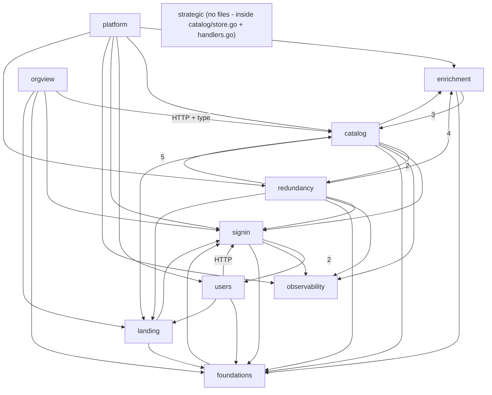

# Evidence: structure

Head 5d99d11, tracked files only, tests excluded from the graph (they are used only in Test risks).
Raw data: `.work/edges-go.csv`, `.work/edges-ts.csv`, `.work/edges-http.csv`, `.work/edges-all.csv`,
`.work/edges-all-annotated.csv` (with capability columns), `.work/symbols-go.csv` (symbol-level Go edges).

## Graph sources

| Language | Source | Level | Confidence | Coverage | Blind spots |
|---|---|---|---|---|---|
| Go (`backend/`) | `go list -deps -export -json` + stdlib `go/types` checker (throwaway program in the session scratchpad, stdlib only), every resolved identifier mapped to its defining **file** | 2 (toolchain) | high for static edges | 26 of 28 non-test `.go` files have edges; `cmd/hashpw/main.go` and `internal/obs/obstest/obstest.go` have no in-repo edges (not "no dependencies": they only use external/stdlib packages) | interfaces satisfied at runtime (`Enqueuer`, `RepoFinder`, `TopicsFetcher`, `Categorizer`) resolve to the interface file, not the implementation; hand wiring in `cmd/shelfmark/main.go`; SQL data coupling |
| TypeScript (`web/app`) | TypeScript 5.9.3 compiler API from `web/node_modules` (`resolveModuleName` with `tsconfig.json`, so `~/*` aliases resolve); `import type` / all-type-only specifiers → `type` | 2 (toolchain) | high | 21 of 21 app files; 1 unresolved import (`root.tsx -> ./app.css`, stylesheet) | `./+types/*` generated route types skipped; route table in `app/routes.ts` is string paths (extracted from `index()/route()` calls, see Mechanical signals) |
| Cross-language HTTP | `/api/...` string literals in `web/app/lib/*.ts` matched to the route table in `backend/cmd/shelfmark/routes.go`, handler symbol → defining file via `symbols-go.csv` | 4 (text match) | medium | 5 lib files → 3 handler files, 16 routes | template-literal paths matched by hand; no OpenAPI or typed client, so a renamed route is invisible to both compilers |

No level-1 tooling exists in the repo (no dependency-cruiser/madge/golangci/arch rules; `web/package.json` scripts are only `build`, `dev`, `typecheck`). [evidence]

**Known distortion (evidence):** Go has one package, `backend/internal/catalog`, holding 13 non-test files that `capabilities.tsv` splits across **catalog, enrichment, redundancy** — and the **strategic** capability has *no* code files at all (footprint = migration 0003). A package-level graph would show one node; everything below is file-level, and strategic/orgview are separated at function level where it was cheap.

## Capability graph

Runtime edges only, `web/app/routes.ts` route-table edges excluded (config-as-code, rule 2), Go + TS + HTTP combined.
Numbers are file-level edges folded with `graph-metrics.mjs --modules capabilities.tsv` (0 unmapped files). [evidence]

| Capability | Ca | Ce | Instability | Note |
|---|--:|--:|--:|---|
| signin | 7 | 3 | 0.30 | most depended-on behaviour capability (session, middleware, `lib/auth.ts`) |
| foundations | 7 | 1 | 0.13 | UI kit; only outgoing edge `root.tsx -> lib/auth.ts` |
| catalog | 4 | 6 | 0.60 | `store.go` is the shared data access for 5 capabilities |
| observability | 4 | 0 | 0.00 | pure leaf |
| landing | 4 | 2 | 0.33 | fan-in is `components/nav.tsx` (shared nav), not the home page |
| enrichment | 3 | 2 | 0.40 | |
| redundancy | 2 | 6 | 0.75 | widest outgoing reach of any feature |
| users | 2 | 3 | 0.60 | |
| platform | 0 | 6 | 1.00 | entry (`cmd/shelfmark`) |
| orgview | 0 | 4 | 1.00 | entry; backend hidden in `catalog/handlers.go` |
| strategic | – | – | – | no files in graph (code inside catalog files) |

Cross-capability runtime edges (file-edge count; lang split): [evidence]

| From → To | n | Files (abridged) |
|---|--:|---|
| redundancy → catalog | 5 | `project*.go -> store.go` (4), `project_handlers.go -> handlers.go` (`writeCatalogError`, `Enqueuer`, `newBatchID`, `maxUploadBytes`), `lib/projects.ts -> lib/catalog.ts` |
| redundancy → enrichment | 4 | `sbom.go, project_sbom.go -> purl.go`; `routes/redundancy.tsx`, kitchen-sink `-> library-status-badge.tsx` |
| redundancy → signin | 4 | `project_handlers.go -> auth/middleware.go, session.go`; route → `lib/auth.ts`, `require-auth.tsx` |
| platform → enrichment / catalog / users / signin / observability / redundancy | 4/2/2/2/2/1 | `main.go`, `routes.go` wiring |
| enrichment → catalog | 3 | `pipeline.go, queue.go, purl.go -> store.go` |
| catalog → signin | 3 | `handlers.go -> auth/middleware.go, session.go`; route → `require-auth.tsx` |
| catalog → redundancy | 2 | `csv.go -> sbom.go` (`Index`, `Reason`), `handlers.go UploadHandler -> sbom.go ParseCycloneDXSBOM` |
| catalog → enrichment | 1 | `csv.go ParsePurlCSV -> purl.go ParsePurl` |
| signin → users | 2 | `auth/handlers.go -> accounts.go, users_store.go` |
| users → signin | 2 | `lib/users.ts -> auth/handlers.go` (HTTP: `/api/users` handlers live in signin's file), `routes/users.tsx -> require-auth.tsx` |
| orgview → catalog | 2 | `lib/organization.ts -> catalog/handlers.go` (HTTP), `routes/organization.tsx -> lib/catalog.ts` |
| landing/orgview/users/catalog/redundancy → landing | 1 each | `components/nav.tsx` |
| * → foundations | 16 | Button/Logo/Badge imports |

## Blast radius per capability

All high-criticality capabilities. "Contracts" = symbols other capabilities use (from `symbols-go.csv`). [evidence unless tagged]

| Capability | Incoming (who breaks if it changes) | Outgoing | Contracts imported by others |
|---|---|---|---|
| catalog | redundancy, enrichment, orgview, strategic*, platform | enrichment (`purl.go`), redundancy (`sbom.go`), signin, observability, foundations, landing | `store.go`: `Store.CreateLibraries` (catalog + redundancy), `Store.UpdateLibraryStatus`, `ListStuckLibraries`, `AttachCategory`, `ListTaxonomy` (enrichment), `StrategicMarksByLibrary`, `NewLibrary`/`Library` types; `handlers.go`: `writeCatalogError`, `Enqueuer`, `newBatchID`, `maxUploadBytes` (redundancy) |
| enrichment | catalog (`csv.go -> purl.go`), redundancy (`purl.go`, status badge), platform (constructs queue + 3 clients) | catalog `store.go` | `ParsePurl`, `Enqueuer.Enqueue` (interface declared in catalog's `handlers.go`), `library-status-badge.tsx` |
| redundancy | catalog (`sbom.go` parser used by catalog CSV/SBOM import), platform | catalog, enrichment, signin, observability, foundations, landing | `ParseCycloneDXSBOM`, `SkippedRow`, `Index`, `Reason` (consumed by catalog import) |
| strategic | `routes.go` → `MarkStrategicHandler`/`UnmarkStrategicHandler`; `lib/organization.ts` (orgview) over HTTP; `ListOrganizationLibrariesHandler` → `Store.StrategicMarksByLibrary`; redundancy report reads `strategic_marks` table in `project.go` SQL | signin (`SessionFromContext`), catalog store | function-level only: `handlers.go` L352–428 (Mark/Unmark handlers, ~77 of 439 lines), `store.go` L384–521 (`MarkStrategic`, `UnmarkStrategic`, `StrategicMarksByLibrary`, ~138 of 521 lines) |
| signin | catalog, redundancy, users, orgview, landing, foundations (`root.tsx`), platform | users (`accounts.go`, `users_store.go`), observability, foundations | `auth.SessionFromContext`, `session.Email`, middleware; `lib/auth.ts` (Ca 7 at file level), `require-auth.tsx` |
| users | signin (`auth/handlers.go` calls `UsersStore`), platform | signin (HTTP handlers + route guard), foundations, landing | `accounts.go` `Role`/`Account` types used by session + middleware |
| platform | none (entry) | 6 capabilities | wiring only; `main.go` Ce 11, `routes.go` Ce 7 (file level) |

\* strategic is reached through catalog files; changing `store.go` or `handlers.go` for any of catalog/enrichment/redundancy/orgview/strategic recompiles and retests the others. [inference]

Data coupling not visible in imports (SQL `FROM/JOIN/INTO/UPDATE` grep, non-test Go): [evidence]
- `strategic_marks`, `libraries`, `library_categories`, `categories`, `project_libraries` are queried in **both** `catalog/store.go` and `catalog/project.go` — the redundancy report reads strategic marks directly via SQL, not via `Store`.
- `store.go ListLibraries` reads `project_libraries` (redundancy's table) to compute `is_direct` (line 161) — catalog → redundancy schema coupling.
- `projects` only in `project.go`; `users` only in `auth/users_store.go`.

## Cycles

Runtime only. [evidence]

- **File level, Go:** one real cycle — `backend/cmd/shelfmark/main.go <-> routes.go` (same package, platform-internal, 2 files). Benign wiring split.
- **File level, TS (route table excluded):** none.
- **Capability level (folded):** `catalog -> enrichment -> catalog -> redundancy -> catalog` (3 nodes) and `signin <-> users`, `foundations <-> signin` (inside a 4-node loop with landing). **None is a file-level cycle** — they appear only because files of one Go package / one auth package are attributed to different capabilities:
  - catalog↔enrichment: `csv.go -> purl.go -> store.go`; smallest loop is 0 files (no path back from `store.go`, which has Ce 0).
  - catalog↔redundancy: `csv.go/handlers.go -> sbom.go -> store.go`; again a shared-parser + shared-store pattern, not a loop.
  - signin↔users: `auth/handlers.go -> users_store.go` and `lib/users.ts -> auth/handlers.go` (HTTP). Cause: the `/api/users` handlers sit in signin's `handlers.go`.
  - foundations↔signin: `root.tsx -> lib/auth.ts` and `login.tsx -> Button/Logo`.
- With routes.ts included the TS graph shows an 8-node capability cycle — mechanical (see below).

## Broken boundaries

Intended layering per capability [inference]: Go `store/parsers (data)` → `pipeline/queue` → `*_handlers.go` → `cmd/shelfmark` wiring; TS `components` → `lib/*.ts` (API client) → `routes/*`.

| Edge | Why it breaks the layering | Tag |
|---|---|---|
| `project_handlers.go -> handlers.go` (`writeCatalogError`, `newBatchID`, `Enqueuer`, `maxUploadBytes`) | feature handler depends on another feature's handler file for shared HTTP helpers; no shared helper file exists | evidence (edge) / inference (judgement) |
| `catalog/csv.go`, `handlers.go UploadHandler -> sbom.go` | catalog import depends on the redundancy SBOM parser; the parser is shared but attributed to redundancy | evidence / inference |
| `handlers.go` hosts handlers of 4 capabilities (catalog upload/list/taxonomy/attach; enrichment `BatchProgressHandler`; orgview `ListOrganizationLibrariesHandler`; strategic Mark/Unmark) | no file boundary between capabilities; `Enqueuer` interface (enrichment contract) is declared in catalog's handler file | evidence |
| `store.go` single `Store` type with no interface | data access for catalog, enrichment, redundancy, strategic and orgview in one concrete type (Ca 8, Ce 0) | evidence |
| `store.go ListLibraries` SQL reads `project_libraries`; `project.go` SQL reads `strategic_marks` | schema-level coupling between catalog, redundancy and strategic that bypasses the Go graph | evidence |
| `auth/handlers.go` contains `/api/users` handlers | users capability's API lives in signin's file | evidence |
| `routes/redundancy.tsx -> lib/catalog.ts` (type), `lib/projects.ts -> lib/catalog.ts` (runtime) | redundancy client reuses catalog client; acceptable shared client, noted | evidence |
| `components/nav.tsx -> lib/auth.ts`; `root.tsx -> lib/auth.ts` | UI foundation/nav layer depends on an API client (signin) | evidence / inference: minor |

## Test risks

From test-file greps (`pgxpool|DATABASE_URL|t.Skip`, `httptest`, constructors used). [evidence; difficulty = inference]

| Capability | Seams | Test shape needed |
|---|---|---|
| catalog / strategic / orgview | `Store` is concrete over `pgxpool`; `handlers_test.go` calls `NewStore(pool)` 47× (with project tests); `store_test.go` starts Postgres (`startTestPostgres`), helpers `countActiveStrategicMarks`, `holdStrategicLock` | integration with real Postgres only; no fake-store seam — strategic cap/locking can only be tested against a DB |
| redundancy | same `Store`; `project_handlers_test.go` 21 httptest refs; parser tests (`sbom_test`, `project_sbom_test`) are pure | parsers unit-testable; handlers/report need DB |
| enrichment | interfaces `RepoFinder`, `TopicsFetcher`, `Categorizer`, `Enqueuer`; pipeline/queue/purl/openrouter tests have no DB or httptest refs | unit with fakes is feasible; external APIs (deps.dev, GitHub, OpenRouter) need mocks (`web/tests/e2e/mocks` exists for e2e) |
| signin | session/middleware tests pure httptest; `auth/handlers_test.go` has 7 DB refs | mostly unit; login handler needs DB (`UsersStore`) |
| users | only `accounts_test.go`; `users_store.go` and the `/api/users` handlers are tested through `auth/handlers_test.go` | integration |
| platform | `db/*_test.go` DB-gated; `routes_test.go` httptest | integration |
| web (all) | no unit test files in `web/`; 4 Playwright e2e files (`auth.setup`, `seed.spec`, `sbom-upload-report.spec`, mocks) | e2e only for frontend |

## Centres and thin entry points

- **Load-bearing centres** [evidence: Ca high, instability low]: `backend/internal/catalog/store.go` (Ca 8, Ce 0, I=0.00) — the de-facto data layer of five capabilities; `web/app/lib/auth.ts` (Ca 7, I=0.13); `web/app/components/button.tsx` (Ca 8, I=0.00, UI kit, low risk); `auth/middleware.go` (Ca 4, I=0.33); observability (Ca 4, Ce 0).
- **Mixed hub**: `catalog/handlers.go` (Ca 4, Ce 6) — not a contract, a multi-capability file that others import helpers from.
- **Thin entry points** [inference]: `cmd/shelfmark/main.go` (Ce 11) and `routes.go` (Ce 7) only construct and route; route files `routes/organization.tsx`, `routes/redundancy.tsx` (Ce 7, Ca 0) are UI entries delegating to `lib/*.ts` clients. orgview's "core" is `ListOrganizationLibrariesHandler` inside catalog.
- **Config-as-code fan-in** (rule 2): `web/app/routes.ts` → 8 route files; checked by `react-router typegen && tsc`, cheap coupling.

## Mechanical signals

| Signal | Count | Why mechanical |
|---|--:|---|
| Route-table edges `web/app/routes.ts -> routes/*.tsx` | 8 | config-as-code (rule 2); including them turns the TS capability graph into one 8-node cycle; excluded from metrics above |
| Type-only edges (TS `import type` / Go type-name-only usage) | 12 (Go 10, TS 2) | rule 9; no type-only cycles; e.g. `redundancy.tsx -> lib/catalog.ts`, `routes.go -> store.go`, `session.go/middleware.go -> accounts.go` |
| Build edges | 0 | no `dist/`/`build/` imports in tracked source |
| Generated route types `./+types/*` | skipped | React Router typegen output, not tracked |
| Capability cycles catalog↔enrichment↔redundancy, signin↔users | 2 | attribution artifacts of shared files in one package (see Cycles); no file-level loop |

## Unknowns

- **Runtime wiring** (unknown): interface implementations (`Enqueuer` → queue, `RepoFinder`/`TopicsFetcher` → deps.dev/GitHub clients, `Categorizer` → OpenRouter) are bound by hand in `main.go`; the static graph points at interface files, not at what runs.
- **In-process queue / goroutines** (unknown): `queue.go` supervision and `ListStuckLibraries` recovery are runtime behaviour, not graph edges.
- **Database as shared state** (partial evidence): only a SQL-keyword grep was done; dynamic SQL, views, triggers and migration-level constraints (e.g. strategic cap per category/ecosystem) are not graphed.
- **HTTP contract** (medium confidence): frontend↔backend matched by string; no generated client or OpenAPI, so the compilers do not guard drift; the Go server also serves the SPA (`spaHandler`) — static assets not graphed.
- **External consumers** (unknown, rule 10): whether anything outside the repo calls `/api/*` is not knowable here.
- **Strategic capability** (unknown at file level): no file of its own; any per-capability structural number for strategic is approximated by function line ranges above.
- **Tests excluded** from the graph; test-to-code edges not computed.
- **Tools worth installing** (not installed, not run): `dependency-cruiser` (TS rules/forbidden-edge checks for `routes -> lib -> components`), `goda` (Go package graph; would still see one `catalog` node — splitting `internal/catalog` into packages would give the graph real boundaries).

## Commands run

- `go list -f '{{.ImportPath}} | {{.GoFiles}} | {{.Imports}}' ./...` (backend)
- `go run` of a stdlib-only `go/types` + `go list -deps -export -json` program (scratchpad) → `edges-go.csv`, `symbols-go.csv`
- `node` script using `web/node_modules/typescript` compiler API → `edges-ts.csv`
- `grep` of `/api/` literals in `web/app` and of `routes.go` registrations → `edges-http.csv`
- `node .claude/skills/10x-repo-map/scripts/graph-metrics.mjs` on each CSV with `--modules capabilities.tsv --kind runtime|type`, `--exclude '^web/app/routes\.ts$'`, `--emit mermaid`, file-level runs
- `python3 -I .work/attribute.py .work/capabilities.tsv` for edge annotation → `edges-all-annotated.csv`
- `git grep` for SQL table access, `strategic` symbols, test DB/httptest usage; `grep -n '^func'` for function line ranges in `store.go`/`handlers.go`
