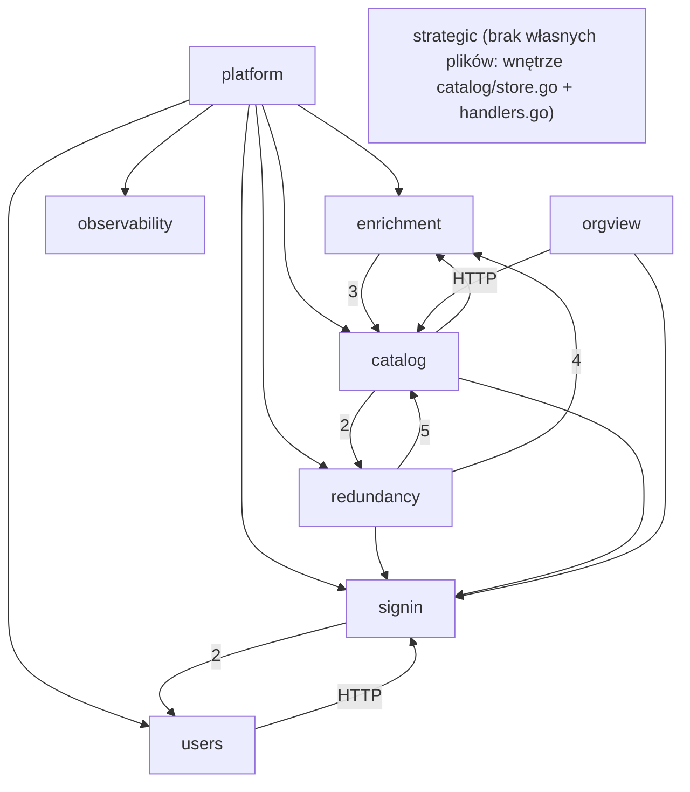

# Mapa repozytorium — Shelfmark

## TL;DR

Shelfmark to wewnętrzne narzędzie do porządkowania bibliotek open source w organizacji. Admin wgrywa katalog bibliotek (CSV), pipeline wzbogaca każdą bibliotekę (deps.dev, GitHub, kategoryzacja przez LLM w OpenRouter), architekci oznaczają biblioteki jako strategiczne w danej kategorii, a zespoły wgrywają SBOM swoich projektów i dostają **raport redundancji**: co jest strategiczne, a co jest kandydatem do wycofania. Backend to jeden moduł Go (`backend/`), frontend to React Router (`web/`), produkcja działa na Fly.io. Praca koncentruje się na raporcie redundancji (trend rosnący, najwięcej planów) i na wspólnej warstwie danych katalogu (`catalog/store.go`, `catalog/handlers.go`). Boli w dwóch miejscach. Pierwsze to raport redundancji i status paczki: dwie kolejne poprawki zaraz po wydaniu na produkcję oraz dwukrotnie naprawiane `null` zamiast `[]`. Drugie to pakiet `catalog`, w którym cztery możliwości biznesowe dzielą jeden plik danych i jeden plik handlerów, a limit znaczników strategicznych naprawiano dwa razy. Historia jest krótka (17 dni, jedna osoba, 80% commitów współtworzonych z agentem AI), więc to mapa młodego projektu, a nie legacy.

*Graf możliwości z `evidence/3-structure.md` (krawędzie runtime Go + TS + HTTP, liczby = krawędzie między plikami). Pominięto, dla czytelności, krawędzie do `foundations`, `landing` i `observability`; pełny graf jest w dowodach.*

## Teren

Buzz: H/M/L względem pozostałych możliwości. Rodziny: *zmiana* (aktywność, trend), *poprawki* (udział fixów produktowych), *tarcie* (drugie podejścia, reverty), *uwaga* (plany), *zasięg* (blast radius w grafie).

| Możliwość | Co robi | Krytyczność | Zmiana | Poprawki | Tarcie | Uwaga | Zasięg | Trend | Gdzie żyje |
|---|---|---|---|---|---|---|---|---|---|
| **Raport redundancji** (`redundancy`) | upload SBOM projektu, raport strategiczne / do wycofania | high: rdzeń wartości, dane użytkownika, zewnętrzny input | H (25 commitów) | H (0.44; 8 fixów produktowych) | H (batch status ×2, null-listy ×2) | H (4 plany + 1 otwarty) | H (Ce 6, I 0.75) | rosnący | `catalog/project*.go`, `sbom.go`, `routes/redundancy.tsx`, `lib/projects.ts` |
| **Katalog** (`catalog`) | import CSV, przeglądanie katalogu i taksonomii | high: rdzeń danych | H (22; `store.go` 11 zmian) | M (0.36; 4 produktowe, głównie limit strategiczny i null) | M | L | H (`store.go` Ca 8) | stały | `catalog/store.go`, `handlers.go`, `csv.go`, `routes/catalog.tsx` |
| **Znaczniki strategiczne** (`strategic`) | oznaczanie biblioteki jako strategicznej per kategoria, limit per (kategoria, ekosystem) | high: rdzeń wartości | ukryta w `catalog` | ukryta w `catalog` (limit naprawiany ×2) | M (2. podejście do limitu) | M (1 plan + 2 jako zakres poboczny) | brak własnych plików | jednorazowy + poprawki | `store.go` L384–521, `handlers.go` L352–428, migracja 0003 |
| **Wzbogacanie i kategoryzacja** (`enrichment`) | kolejka, deps.dev, GitHub, LLM, status paczki | high: rdzeń, integracje zewnętrzne | M (10, skok w W44) | M (0.40, ale głównie rozlane review-fixy) | M (status paczki, wspólny z raportem) | L | M (Ca 3) | rosnący | `catalog/pipeline.go`, `queue.go`, `openrouter.go`, `depsdev.go`, `github.go`, `purl.go` |
| **Logowanie i role** (`signin`) | sesja, middleware ról, guardy w UI | high: tożsamość i dostęp | M (18) | L (0.33, prawie same review-fixy) | L | L | H (Ca 7; `lib/auth.ts` Ca 7) | stały | `auth/session.go`, `middleware.go`, `handlers.go`, `lib/auth.ts` |
| **Użytkownicy** (`users`) | admin zarządza użytkownikami i rolami | high: dostęp | L (7) | L (n=7, fixy przekrojowe) | L | L | L (Ca 2) | sezonowy | `auth/accounts.go`, `users_store.go`, `routes/users.tsx` |
| **Widok organizacji** (`orgview`) | przekrój bibliotek w całej organizacji | medium | L (4) | L | L | L | L (punkt wejścia) | wygasający | `routes/organization.tsx`, backend w `catalog/handlers.go` |
| **Obserwowalność** (`observability`) | logi strukturalne, middleware żądań, nadzór kolejki | medium | L (2) | L | L | L | M (Ca 4, liść) | nowy | `backend/internal/obs/` |
| **Strona główna i nawigacja** (`landing`) | home, dashboard, menu | low | L | L | L | L | L | wygasający | `routes/home.tsx`, `dashboard.tsx`, `components/nav.tsx` |

Kubełki niebiznesowe:
- **Platforma i infrastruktura**: CI/CD z deployem na Fly.io, Dockerfile, bootstrap serwera (`cmd/shelfmark/main.go` 16 zmian, `routes.go`), pula DB i migracje, hooki agenta. Krytyczność high (deploy może położyć produkcję), ale wysoki udział fixów to praca metodą prób (patrz „Wygląda groźnie, ale nie jest”).
- **Wspólne fundamenty UI**: tokeny w `app.css`, `Button`/`Badge`/`Logo`, `root.tsx`, tabela tras `routes.ts`. Wysoki fan-in (Ca 7), niskie ryzyko.
- **Dokumentacja i planowanie**: `context/` (PRD, roadmapa, 17 zarchiwizowanych zmian, plany, review). To 49% wszystkich zmian, bo każda zmiana 10x zapisuje plan obok kodu. To dyskusja, nie aktywność kodu.

Pokrycie: 575 policzonych zmian; z 294 zmian w kodzie nieprzypisane są 2 (usunięty szkielet `web/app/welcome`), platforma + fundamenty to 33%. Rozjazd struktury z możliwościami: **jeden pakiet Go `internal/catalog` obsługuje pięć możliwości** (katalog, wzbogacanie, raport redundancji, znaczniki strategiczne, widok organizacji); **jeden plik `auth/handlers.go` obsługuje logowanie i zarządzanie użytkownikami**.

## Realne powiązania

| Powiązanie | Skąd wiem | Charakter |
|---|---|---|
| raport redundancji → katalog: `project*.go → store.go` (4 pliki), `project_handlers.go → handlers.go` (`writeCatalogError`, `newBatchID`, `Enqueuer`, `maxUploadBytes`) | graf runtime + współzmiana 11 commitów (0.50) | ręczne, realne; handler jednej możliwości importuje pomocniki z handlera drugiej |
| katalog → raport redundancji: import CSV i upload używają parsera SBOM z `sbom.go` | graf runtime | ręczne; parser wspólny, ale leży po stronie raportu |
| raport redundancji ↔ znaczniki strategiczne ↔ katalog przez bazę: `project.go` czyta `strategic_marks` bezpośrednio w SQL, `store.go ListLibraries` czyta `project_libraries` | grep SQL (poza grafem importów) | ręczne, niewidoczne dla kompilatora |
| wzbogacanie → katalog: `pipeline.go`, `queue.go`, `purl.go → store.go` | graf runtime + współzmiana 5 (0.50) | ręczne |
| raport redundancji ↔ wzbogacanie: status paczki w raporcie | współzmiana 5 (0.50) + graf (`purl.go`, `library-status-badge.tsx`) | ręczne; tu wylądowały oba fixy statusu paczki |
| logowanie ↔ użytkownicy: handlery `/api/users` w `auth/handlers.go` | graf runtime + współzmiana 5 (0.71) | ręczne; pętla wynika z rozmieszczenia plików, nie z cyklu |
| frontend ↔ backend: `web/app/lib/*.ts` → handlery Go | dopasowanie stringów `/api/...` (średnia pewność) | ręczne; brak typowanego klienta i OpenAPI, rename trasy nie zostanie wychwycony przez żaden kompilator; tylko katalog ma `json_contract_test.go` |
| platforma → wszystko: `main.go` (9 partnerów), `routes.go` | współzmiana + graf | **mechaniczne** (wiring i tabela tras) |
| `web/app/routes.ts` → 8 plików tras | graf TS | **mechaniczne** (konfiguracja jako kod, pilnowana przez typegen + tsc) |

Cykle: jedyny realny cykl plikowy to `main.go ↔ routes.go` (platforma, nieszkodliwy). Pętle między możliwościami (katalog ↔ wzbogacanie ↔ raport, logowanie ↔ użytkownicy) to artefakt przypisania plików jednego pakietu do różnych możliwości. Nie ma tam pętli między plikami.

## Strefy ryzyka

### 1. Raport redundancji i status paczki
**Dlaczego:** rdzeń wartości produktu i miejsce, gdzie po wydaniu na produkcję wylądowały dwie kolejne poprawki tego samego zachowania.
- *Poprawki* (`1-history.md`, Fix pressure): 11 z 25 commitów to fixy, 8 z nich produktowe (pusta paczka ustala się jako done, prawdziwy status paczki, listy nigdy `null`, anulowanie starego pollingu, sesja przed zapisem do DB).
- *Tarcie* (`2-discussion.md`, Second attempts): `batch-status-uncategorized-libraries`, a tego samego dnia (2026-10-27) `empty-batch-status`; null-listy naprawiane w `projects-empty-list-null-fix` (10-21) i ponownie w `testing-access-control-data-integrity` p2 (10-26). Jedyny wpis w `lessons.md` dotyczy właśnie `null` zamiast `[]`.
- *Zasięg* (`3-structure.md`): największy zasięg wychodzący (Ce 6, I 0.75); zależy od katalogu, wzbogacania i logowania.
- Kontrola niezależności: *zmiana* i *uwaga* (plany) mają jedną przyczynę: możliwość jest dopiero budowana. Liczę je raz. Poprawki, tarcie i zasięg pochodzą z innych źródeł.
- Pliki: `backend/internal/catalog/project.go`, `project_handlers.go`, `project_sbom.go`, `sbom.go`, `web/app/routes/redundancy.tsx`, `web/app/lib/projects.ts`.

### 2. Wspólna warstwa danych katalogu ze znacznikami strategicznymi
**Dlaczego:** jeden konkretny typ `Store` bez interfejsu obsługuje pięć możliwości, a jedyny twardy niezmiennik biznesowy (limit znaczników strategicznych) był naprawiany dwukrotnie.
- *Zasięg* (`3-structure.md`): `store.go` ma Ca 8, Ce 0 (de facto warstwa danych pięciu możliwości); `handlers.go` miesza handlery czterech możliwości i eksportuje pomocniki dla raportu. Brak szwu do testów: logikę limitu da się sprawdzić tylko na prawdziwym Postgresie.
- *Poprawki / tarcie* (`1-history.md`, `2-discussion.md`): limit strategiczny w `org-data-fixes-and-user-management` p1 (10-20), potem „Strategic cap — contract, edges, concurrency” w `testing-access-control-data-integrity` p3 (10-26), gdzie wyszedł prawdziwy wyścig (3–5 aktywnych znaczników przy równoległych żądaniach) naprawiony `pg_advisory_xact_lock`. Pierwotna zmiana `mark-strategic-libraries` dostała impl-review NEEDS ATTENTION.
- *Zmiana*: `store.go` i `handlers.go` to najczęściej zmieniane pliki produktowe (11 i 9).
- Kontrola niezależności: poprawki i zasięg mają różne źródła (historia vs graf). Część tej presji to rozlane fixy przekrojowe (4 z 8 fixów dotyka >3 możliwości), więc liczę tylko fixy o limicie i null-listach.
- Pliki: `backend/internal/catalog/store.go`, `backend/internal/catalog/handlers.go`, `backend/internal/db/migrations/0003_strategic_marks.up.sql`.

### Do obserwacji (*watch*)
- **Wzbogacanie i kategoryzacja.** Rdzeń z trzema integracjami zewnętrznymi i udział fixów 0.40, ale większość tych fixów to przekrojowe commity z review (reguła 12), a zasięg jest umiarkowany. Jest jedyną możliwością z interfejsami do testów z fakeami. Wraca do strefy, jeśli status paczki znów się zepsuje.
- **Logowanie i role.** Najwyższy fan-in (Ca 7), ale fixy to prawie wyłącznie review-fixy, bez drugich podejść. Wysoki zasięg przy niskiej presji to pytanie: czy niska presja to dobra jakość, czy brak użycia na produkcji?

### Wygląda groźnie, ale nie jest
- **`context/` = 49% zmian, 121/125 commitów**: proza planistyczna workflow 10x i 17 przenosin do archiwum (reguła 8).
- **`cmd/shelfmark/main.go` jako najczęściej zmieniany plik (16) z 9 partnerami** i **`web/app/routes.ts`**: wiring i tabela tras (reguła 2).
- **Udział fixów platformy (0.24)**: deploy i CI dopracowywane metodą prób (reguła 5).
- **11 commitów „impl-review fixes”**: krok procesu 10x, nie defekty z produkcji; każdy dotyka kilku możliwości i zawyża małe (reguły 5 i 12).
- **Użytkownicy z udziałem fixów 0.43**: n=7, dwa z trzech fixów są przekrojowe.
- **PR #1 i #2 dotykające wszystkiego**: jedna gałąź kamienia milowego; PR #6/#8 i #9/#10 to te same zmiany wmergowane dwa razy.
- **Pętle katalog ↔ wzbogacanie ↔ raport i logowanie ↔ użytkownicy**: artefakt przypisania plików jednego pakietu, nie cykl plików.
- **100% koncentracji wiedzy w jednej osobie**: przy jednym człowieku to punkt odniesienia, nie ustalenie (reguła 6).

## Kogo zapytać

Punkt odniesienia: w oknie jest **jeden człowiek**, Tomasz Świerszcz (tswierszcz), a 80% commitów ma współautora AI (Claude). Pytanie „kogo” zamienia się więc w „gdzie jest zapisane uzasadnienie”: zakres commita to change-id, a uzasadnienie leży w `context/archive/<data>-<change-id>/`.

| Strefa | Osoba | Gdzie jest uzasadnienie |
|---|---|---|
| Raport redundancji i status paczki | Tomasz Świerszcz | archiwum: `project-redundancy-report`, `projects-empty-list-null-fix`, `batch-status-uncategorized-libraries`, `empty-batch-status`; otwarta, wstrzymana `context/changes/testing-redundancy-report-correctness/` |
| Warstwa danych katalogu i znaczniki strategiczne | Tomasz Świerszcz | archiwum: `mark-strategic-libraries` (jedyna zmiana funkcjonalna bez trailera agenta, więc plan może być jedynym zapisem), `org-data-fixes-and-user-management`, `testing-access-control-data-integrity` |

## Pierwszy dzień

1. `context/foundation/prd.md` — po co jest produkt (FR-005, FR-007, FR-008 to reguły raportu i limitu).
2. `backend/cmd/shelfmark/routes.go` — tabela tras API z rolami; mapa wszystkich wejść backendu.
3. `web/app/routes/redundancy.tsx` — główny ekran produktu: upload SBOM, polling statusu paczki, raport.
4. `backend/internal/catalog/project_handlers.go` — wejście API raportu redundancji (upload, raport, status).
5. `backend/internal/catalog/project.go` — tu naprawdę żyje logika raportu (SQL agregacji, w tym bezpośredni odczyt `strategic_marks`).
6. `backend/internal/catalog/store.go` — wspólna warstwa danych pięciu możliwości, z limitem strategicznym w `MarkStrategic`.
7. `backend/internal/catalog/pipeline.go` — wzbogacanie biblioteki i ustawianie statusu, który potem pokazuje raport.
8. `context/foundation/lessons.md` — jedna, ale powtarzająca się pułapka (`nil` slice → JSON `null`).

## Ograniczenia

- **Okno:** cała historia, czyli tylko 17 dni (2026-10-10..2026-10-27), 4 tygodniowe kubełki, z czego ostatni ma 2 dni. Trendy mają niską pewność; to mapa młodego projektu, nie legacy.
- **Źródła:** git + gh. Na forge'u jest 12 PR-ów, 0 issues i 0 ludzkich review lub komentarzy; całe review odbywa się w repo, w raportach agentów (`plan-review`, `impl-review`). Nie ma error trackera, więc tempo defektów na produkcji jest nieznane (`unknown`).
- **Graf:** Go i TypeScript na poziomie kompilatora (wysoka pewność). Kontrakt HTTP frontend ↔ backend tylko przez dopasowanie stringów (średnia). Nie widać wiązania interfejsów w `main.go`, kolejki w procesie ani sprzężeń przez bazę poza grepem SQL (`unknown`). Konsumenci API spoza repo: `unknown (external)`.
- **Pokrycie możliwości:** 2 nieprzypisane zmiany (usunięty szkielet), platforma + fundamenty 33% zmian w kodzie. **Znaczniki strategiczne nie mają własnych plików**, więc ich aktywność i fixy są liczone pod katalogiem; liczby na poziomie funkcji (zakresy linii) są przybliżeniem. Przypisanie planów do możliwości jest wywnioskowane z zakresów commitów.
- **Ludzie:** jeden człowiek; nie da się ocenić, ile każdej zmiany napisał człowiek, a ile agent. Siedem commitów `mark-strategic-libraries` nie ma trailera agenta i nie wiadomo dlaczego.
- **Narzędzia niezainstalowane (rekomendacja):** `dependency-cruiser` (reguły zakazanych krawędzi `routes → lib → components` w `web/`), `goda` (graf pakietów Go; i tak zobaczy jeden węzeł `catalog`, dopóki pakiet nie zostanie podzielony).
- **Czego mapa NIE mówi:** czy raport redundancji liczy poprawnie (to pytanie do researchu L3 i Fazy 3 test-planu); czy bliźniacze typy Go ↔ TS (`project.go`/`store.go` vs `web/app/lib/*.ts`) są czymś pilnowane poza `json_contract_test.go` katalogu.
- **Niewiadome warte osobnej analizy:** (1) przepływ upload SBOM → wzbogacanie → status paczki → raport, od końca do końca; (2) czy podział pakietu `catalog` na możliwości jest wart kosztu; (3) czy brak typowanego kontraktu HTTP już coś zepsuł (null-listy sugerują, że tak).
